# LiveOrder — Bộ sơ đồ slide: Pipeline toàn dự án (Aho-Corasick & RAG)

> Tài liệu này là **bản Mermaid song song** với file trình chiếu
> [`LiveOrder-pipeline-slides.pptx`](./LiveOrder-pipeline-slides.pptx) (13 slide, 16:9).
> Nội dung bám theo code đang chạy — không phải sơ đồ lý thuyết.
>
> **Cách dùng**
> - Mở bằng VS Code + extension *Markdown Preview Mermaid Support*, hoặc dán từng khối vào
>   [mermaid.live](https://mermaid.live) để export PNG/SVG.
> - GitHub render Mermaid sẵn khi đẩy file lên.
> - Muốn chỉnh slide: sửa `scripts/generate_pipeline_slides.py` rồi chạy lại
>   `python scripts/generate_pipeline_slides.py`.
>
> **Nguồn code:** `lib/aho-corasick.ts`, `lib/live/service.ts`, `lib/live/gateway.ts`,
> `lib/rag/*`, `lib/chat/ai.ts`, `lib/chat/flow.ts`, `lib/chat/gateway.ts`,
> `prisma/schema.prisma`, `server.ts`.

---

## Bản đồ 13 slide

| # | Slide | Nội dung chính |
|---|---|---|
| 1 | Bìa | LiveOrder · Pipeline toàn dự án · 2 lõi |
| 2 | Bài toán | 3 nỗi đau → 2 lõi → 3 kết quả |
| 3 | Kiến trúc | Một process, hai namespace socket, một DB |
| 4 | Pipeline tổng | Live commerce + AI 24/7 chạy song song |
| 5 | Aho-Corasick — thuật toán | Trie, fail link, quét một lượt, word boundary |
| 6 | Aho-Corasick — pipeline | Comment → match → eventId → transaction → realtime |
| 7 | Aho-Corasick — bằng chứng | Ví dụ thật + ca biên + 3 bất biến |
| 8 | RAG — tổng quan | Hai pha: nạp lazy & truy vấn |
| 9 | RAG — pha nạp | Index theo shop, RAM, invalidate |
| 10 | RAG — pha truy vấn | Router 3 nhánh, top-5, context, fallback |
| 11 | RAG — prompt & chốt chặn | Prompt, trace, 4 guardrail |
| 12 | Vận hành | Kịch bản demo 10 phút, 2 lõi gặp nhau |
| 13 | Tổng kết | 3 câu chốt + stack |

---

## Slide 2 — Bài toán: 3 nỗi đau, 2 lõi

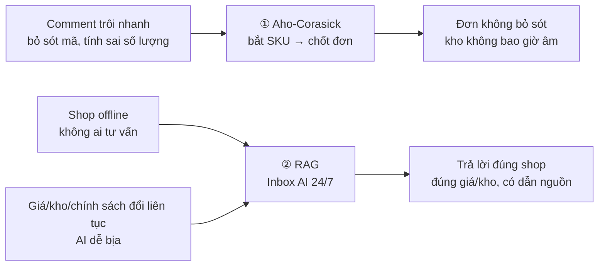

**Lời thoại gợi ý**

- Bài toán không phải “làm chatbot”, mà là **hai đường dữ liệu**: comment → đơn, và câu hỏi → tri thức shop.
- Aho-Corasick giải quyết **tốc độ + chính xác vị trí**; RAG giải quyết **tri thức + tính đúng thời điểm**.
- Tiêu chí thành công: đơn không bỏ sót, AI 24/7 đúng shop, kho không âm.

---

## Slide 3 — Kiến trúc tổng thể

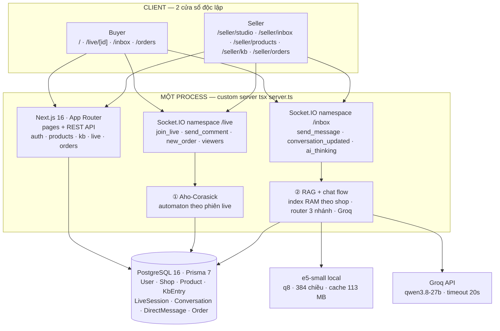

**Điểm cần nói**

- Chỉ **một process**: Next.js + socket.io, không tách service.
- Danh tính **chỉ từ JWT** ở handshake; payload `userId`/`role`/`buyerId` bị bỏ qua.
- `globalThis` giữ đúng **một embedder + một index** cho cả process, dù Next biên dịch nhiều bundle.
- DB là nguồn sự thật duy nhất: giá, kho, trạng thái đơn, `mode/version` hội thoại.

---

## Slide 4 — Pipeline toàn dự án (sơ đồ xương sống)

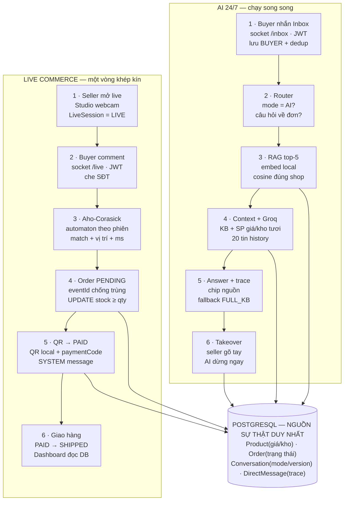

**Điểm cần nói**

- Hai lane **không phụ thuộc nhau**: AI vẫn trả lời khi shop offline; nhưng cả hai đọc cùng DB.
- Mọi thứ realtime đều đi qua socket.io; REST chỉ làm thao tác nghiệp vụ (mở/đóng live, CRUD, thanh toán).
- Nhắc thanh toán là “dây nối” giữa hai lane: đơn PENDING từ live → tin SYSTEM trong Inbox.

---

## Slide 5 — Aho-Corasick: thuật toán

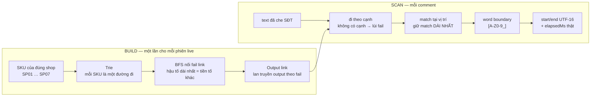

**Các con số**

| Thành phần | Chi phí |
|---|---|
| Build trie + fail link | `O(Σ độ dài SKU)` — một lần / phiên |
| Quét một comment | `O(n + số match)` |
| Bộ nhớ automaton | một automaton / `sessionId`, cache trong `Map` |
| Thời gian hiển thị | `performance.now()` — số thật, không hard-code |

**Quy tắc match**

- Không phân biệt hoa/thường; chuẩn hoá từng code unit để không lệch chỉ số UTF-16.
- Ký tự trước `start` và sau `end` không thuộc `[A-Z0-9_]` → `SP01` không khớp trong `SP010`, `xSP01`, `SP01_x`.
- Mỗi vị trí bắt đầu chỉ trả match dài nhất: `SP010` thắng `SP01`, không trả trùng bản ngắn.
- Chỉ nạp SKU của **đúng shop đang live** → không lẫn shop.

---

## Slide 6 — Aho-Corasick: comment → đơn

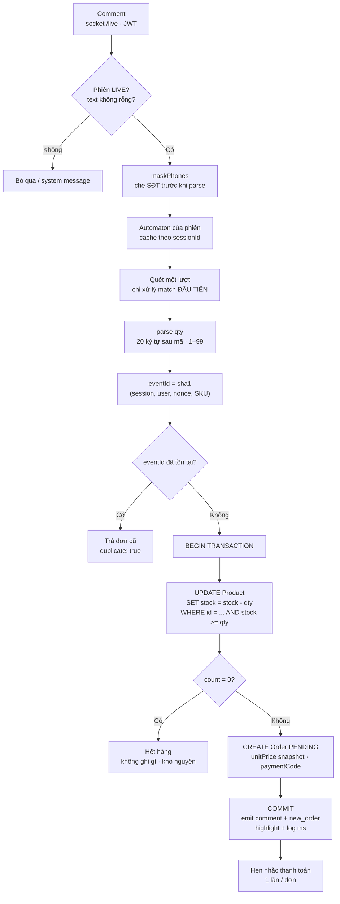

**Ba kết quả có thể xảy ra**

| Kết quả | Điều kiện | Hành vi |
|---|---|---|
| Tạo đơn | `count = 1` | Order PENDING + `new_order` + toast 2 cửa sổ |
| Hết hàng | `count = 0` | Không ghi gì, phát `SPxx đã hết hàng` |
| Trùng nonce | `eventId` đã có / P2002 | Trả đơn cũ, `duplicate: true`, không phát `new_order` lần 2 |

**Điểm bảo vệ**

- Điều kiện `stock >= qty` nằm **trong chính câu UPDATE**, trong cùng transaction với `INSERT Order`.
- PostgreSQL row-lock rồi đánh giá lại điều kiện → hai khách tranh 1 món chỉ một người thắng.
- `unitPrice` là snapshot tại lúc chốt đơn — đổi giá sau đó không làm sai đơn cũ.
- Comment đã che SĐT **trước khi** quét, nên `start/end` khớp đúng chuỗi phát cho client.

---

## Slide 7 — Aho-Corasick: bằng chứng

```text
> lấy SP01 2 cái
  match   SP01          [4, 8)
  qty     2             (cửa sổ 20 ký tự sau mã)
  time    0.31 ms       (performance.now)
  order   #12 · 300.000đ · PENDING
  stock   8 → 6
  // comment đã được che SĐT trước khi quét
```

| Input | Kết quả |
|---|---|
| `SP01 2 cái` | ✓ match + qty 2 |
| `SP010` | ✗ không khớp `SP01` |
| `xSP01` | ✗ sai word boundary |
| `SP01SP02` | ✗ dính chữ — không mã nào |
| `SP01 100 cái` | ✓ qty 1 (số 3 chữ số không phải qty) |
| `0912 345 678` | → `0912***678` |
| 2 khách · kho 1 | ✓ đúng 1 đơn |

**Ba bất biến**

1. **Đúng shop** — `SP01` của shop A và shop B là hai sản phẩm khác nhau; automaton chỉ nạp SKU của shop phiên live.
2. **Đúng kho** — trừ kho nguyên tử; không bao giờ âm; hủy đơn PENDING hoàn kho trong cùng transaction.
3. **Đúng vị trí** — `start/end` là chỉ số UTF-16 trên chuỗi đã che; client cắt highlight từ chính text nhận được.

---

## Slide 8 — RAG: hai pha

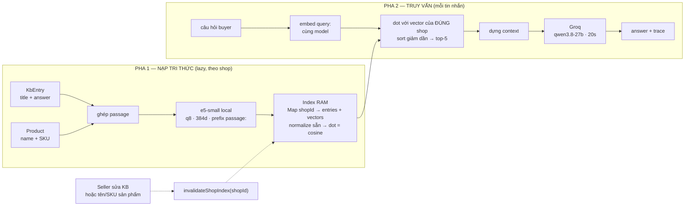

**Hai điều quan trọng nhất**

- **Giá/kho KHÔNG nằm trong vector.** Chỉ tên/SKU sản phẩm được embed; giá/kho đọc tươi từ DB lúc dựng prompt.
- **Sửa KB hoặc tên/SKU** → invalidate index → lần truy vấn kế tiếp dựng lại. Không cần restart.

---

## Slide 9 — RAG: pha nạp tri thức

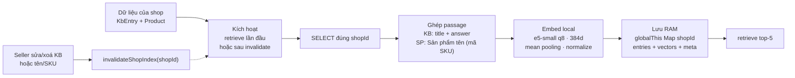

**Bản ghi index trong RAM**

```text
Map<shopId, ShopIndex>
  meta:    modelId · revision · builtAt · kbCount · productCount
  entries: id · kind(kb|product) · title · sku?
  vectors: number[][] · 384 chiều · đã normalize
```

**Điểm cần nói**

- Index **lazy**: không đụng DB/model lúc import; shop nào được hỏi lần đầu mới dựng.
- **Một model / process** nhờ `globalThis.__ragEmbedder`; cache `.cache/transformers` ~113 MB.
- Vector normalize sẵn → cosine chỉ là dot product; `topK` mặc định 5.
- Index **không bền**: restart server → dựng lại; đổi giá/kho không invalidate.
- Cô lập shop: `SP01` shop A và `SP01` shop B có index/vector riêng.

---

## Slide 10 — RAG: pha truy vấn

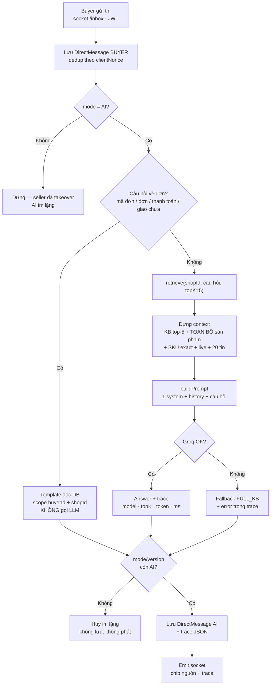

**Router 3 nhánh**

| Nhánh | Điều kiện | Hành vi |
|---|---|---|
| Takeover | `conversation.mode = HUMAN` | AI không chạy |
| Tra đơn | regex `#số` hoặc `đơn/thanh toán/chuyển khoản/giao chưa` | Template DB, không LLM, không bịa trạng thái |
| RAG | còn lại | top-5 + context + Groq; lỗi Groq → fallback FULL_KB |

**Takeover thắng cả khi đang bay**

1. Chốt `mode/version` tại lúc dispatch.
2. Runner trả về (thành công hay lỗi).
3. Đọc **lại** hội thoại; nếu `mode !== AI` hoặc `version` đổi → hủy toàn bộ kết quả, không lưu, không phát.
4. `ai_thinking(false)` vẫn phát ở `finally` để UI không kẹt spinner.

---

## Slide 11 — Prompt, trace và 4 chốt chặn

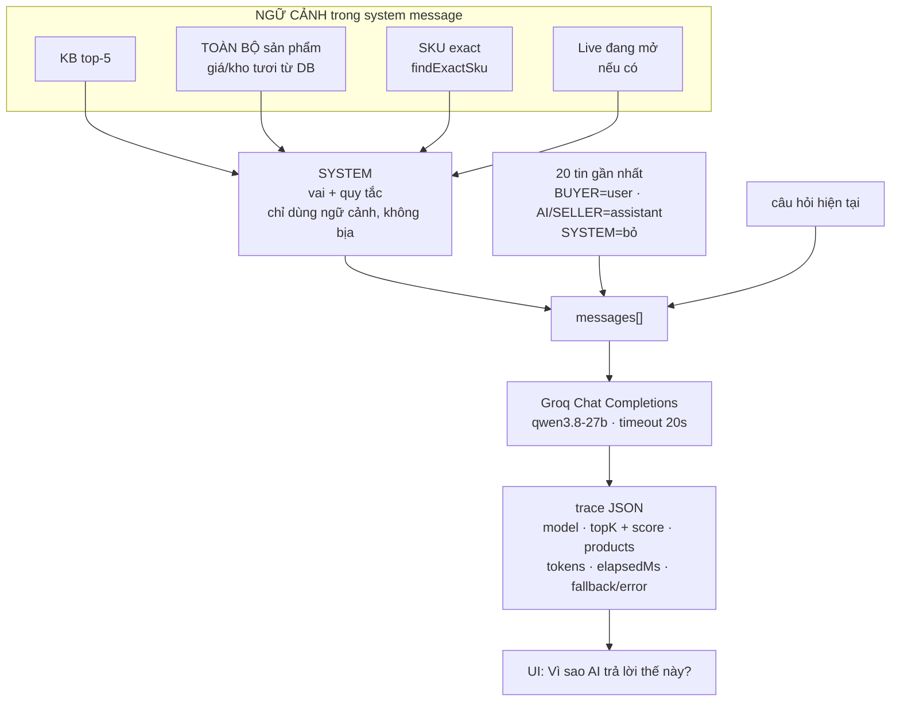

**Bốn chốt chặn**

| Chốt chặn | Cơ chế |
|---|---|
| **Cô lập shop** | Mọi query filter `shopId`; index riêng; SKU nêu rõ tra `findExactSku`, không thay bằng cosine |
| **Đơn không bịa** | Câu hỏi đơn đi template DB theo `buyerId + shopId`; trạng thái luôn khớp thực tế |
| **Takeover thắng** | Đọc lại `mode/version` sau khi AI trả lời; lệch → hủy im lặng |
| **Trace minh bạch** | Lưu `DirectMessage.trace`; UI hiển thị model, nguồn, token, thời gian, fallback |

**Tham số đang dùng**

| Tham số | Giá trị | Nơi khai báo |
|---|---|---|
| Embedding | `Xenova/multilingual-e5-small` q8 · 384d | `lib/rag/embedder.ts` |
| Tiền tố e5 | `query:` / `passage:` | `buildEmbedText` |
| top-K | 5 | `DEFAULT_TOP_K` — `lib/rag/index.ts` |
| Độ tương đồng | cosine = dot trên vector đã normalize | `dot()` |
| Lịch sử | 20 tin gần nhất | `HISTORY_TAKE` — `lib/chat/flow.ts` |
| LLM | `qwen/qwen3.8-27b` (override `GROQ_MODEL`) | `lib/rag/groq.ts` |
| Timeout LLM | 20 giây | `DEFAULT_TIMEOUT_MS` |
| Fallback | toàn bộ KB của shop (`FULL_KB`) | `buildFallbackContent` — `lib/chat/ai.ts` |
| Câu hỏi đơn | `#số` hoặc `đơn/thanh toán/chuyển khoản/giao chưa` | `isOrderQuestion` |

---

## Slide 12 — Vận hành: kịch bản demo 10 phút

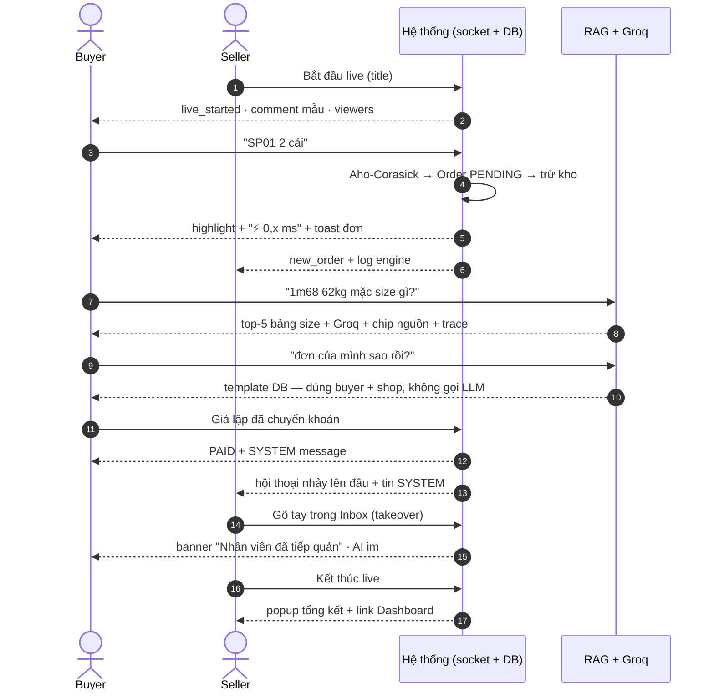

**Bằng chứng tại mỗi mốc**

- Log `⚙️ bắt "SP01" → Đơn #X · 0,x ms` ở Studio là **số đo thật**.
- Chip nguồn + khối “Vì sao AI trả lời thế này?” hiển thị top-5, model, token, thời gian.
- Trạng thái đơn và doanh thu trên Dashboard đọc thẳng từ DB, không tính lại ở client.

---

## Slide 13 — Tổng kết

```text
① Aho-Corasick
   - 1 lượt quét / comment · O(n + matches)
   - 0,x ms đo bằng performance.now()
   - UPDATE ... WHERE stock >= qty trong transaction
   - highlight đúng vị trí UTF-16

② RAG
   - top-5 cosine trên vector normalize
   - e5-small 384d, embedding 100% local
   - timeout 20s + fallback toàn bộ KB
   - trace: model · nguồn · token · thời gian

Niềm tin
   - takeover + trace + fallback
   - người thật luôn thắng, AI không bịa
```

---

## Phụ lục A — Mô hình dữ liệu (ERD)

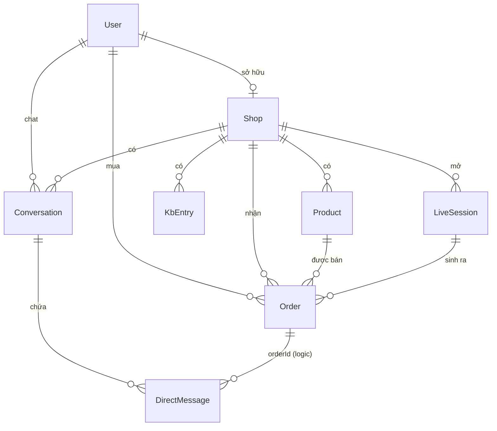

**Ràng buộc quan trọng**

- `Product @@unique([shopId, sku])` — `SP01` của hai shop là hai bản ghi khác nhau.
- `Order.eventId @unique` — chống trùng khi client retry / double-click.
- `Order.paymentCode @unique` — in lên QR của đơn PENDING.
- `DirectMessage.dedupKey @unique` — chống trùng tin SYSTEM/AI (nhắc thanh toán, thanh toán).
- `Conversation @@unique([buyerId, shopId])` + `mode/version` — takeover và chống race.

---

## Phụ lục B — Thành phần ↔ file code

| Thành phần | File | Vai trò |
|---|---|---|
| Aho-Corasick | `lib/aho-corasick.ts` | Trie, fail link, word boundary, đo ms |
| Pipeline comment → đơn | `lib/live/service.ts` | mask SĐT, match, qty, eventId, transaction kho + Order |
| Socket live | `lib/live/gateway.ts` | JWT handshake, phát comment/new_order, fake comments |
| Inbox flow | `lib/chat/flow.ts` | Lưu tin, router, history 20, takeover race, emit |
| AI runner | `lib/chat/ai.ts` | 3 nhánh: template đơn / RAG / fallback FULL_KB |
| RAG index | `lib/rag/index.ts` | Index RAM theo shop, cosine top-5, `findExactSku`, invalidate |
| Embedder | `lib/rag/embedder.ts` | e5-small q8 384d, lazy, singleton `globalThis` |
| Groq client | `lib/rag/groq.ts` | HTTP thuần, timeout 20s, `GroqError` |
| Trace | `lib/chat/trace.ts` | Schema trace an toàn cho client |
| Inbox gateway | `lib/chat/gateway.ts` | JWT, quyền hội thoại, validate payload |
| Socket live | `lib/live/gateway.ts` | `/live` namespace |
| Custom server | `server.ts` | Next.js + socket.io cùng process |
| Schema | `prisma/schema.prisma` | 8 model + enum + unique/index |

---

## Phụ lục C — Câu hỏi hội đồng có thể hỏi

| Câu hỏi | Trả lời ngắn |
|---|---|
| Vì sao dùng Aho-Corasick thay vì regex? | Một lượt quét cho nhiều SKU, `O(n + matches)`, trả vị trí chính xác; regex nhiều mẫu dễ backtrack và khó highlight đúng. |
| Vì sao không dùng vector DB? | Demo một process, dữ liệu nhỏ; index RAM đủ nhanh, ít vận hành. Đổi lại: không bền, restart phải dựng lại — đã ghi rõ giới hạn. |
| Làm sao AI không bịa giá/kho? | Giá/kho không embed; prompt luôn chèn toàn bộ sản phẩm đọc tươi từ DB. Trace ghi lại đúng dữ liệu lúc trả lời. |
| Làm sao không lẫn shop? | Mọi query filter `shopId`; index riêng; `findExactSku` theo `[shopId, sku]`; test 2 shop cùng `SP01`. |
| Hai khách tranh 1 món thì sao? | `UPDATE ... WHERE stock >= qty` trong transaction; PostgreSQL row-lock; một người `count=1`, người kia `count=0` → hết hàng. |
| Seller takeover khi AI đang trả lời? | Chốt `version` lúc dispatch; sau khi runner trả về đọc lại; lệch → hủy im lặng. |
| Groq lỗi/mất mạng? | `GroqError` → fallback toàn bộ KB của shop + lỗi trong trace; không crash, không bịa. |
| Vì sao embedding local? | Dữ liệu shop không gửi ra dịch vụ ngoài; chạy CPU; cache 113 MB; lần đầu chậm, sau đó nhanh. |
