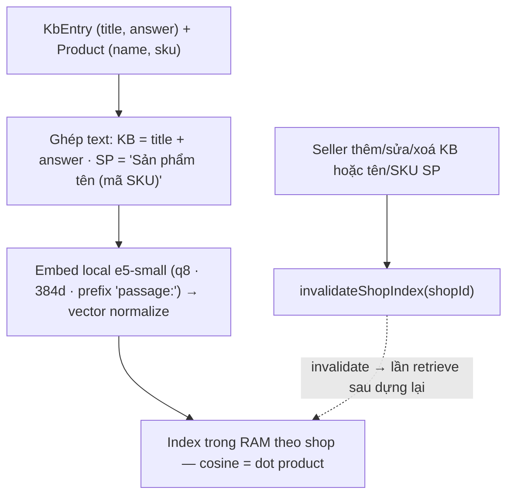
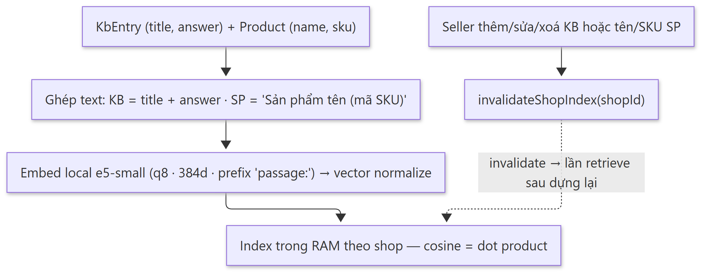
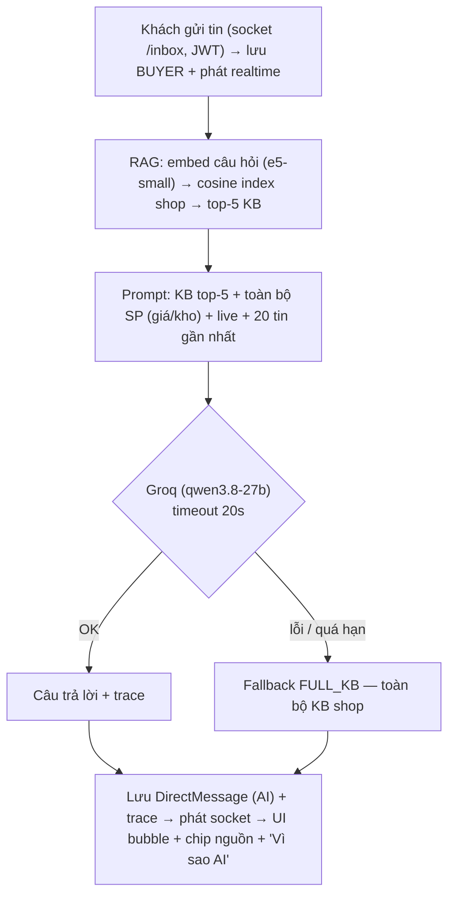
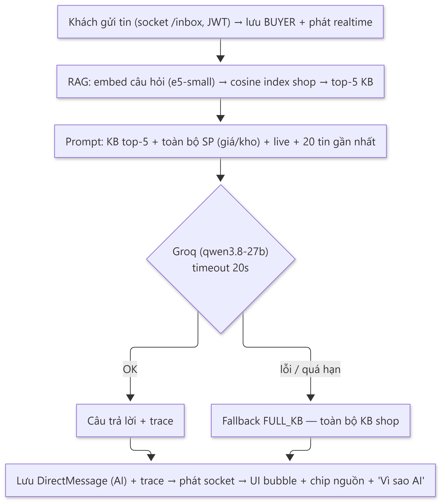
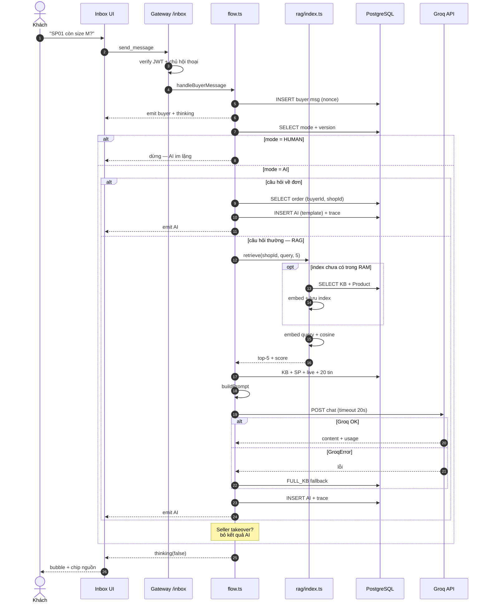
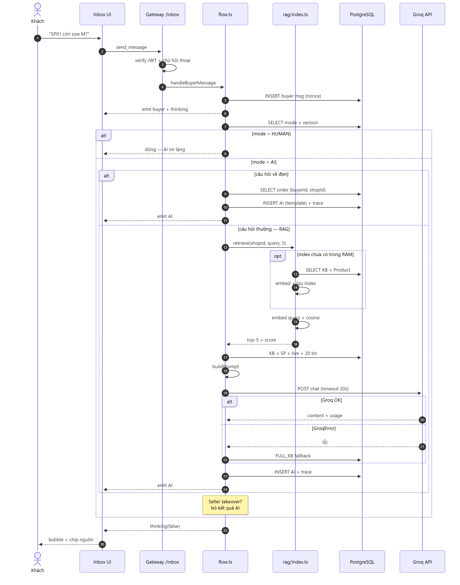
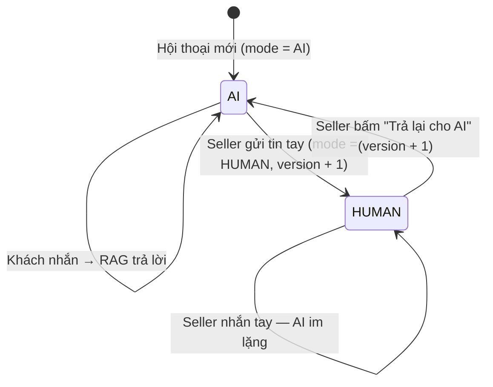
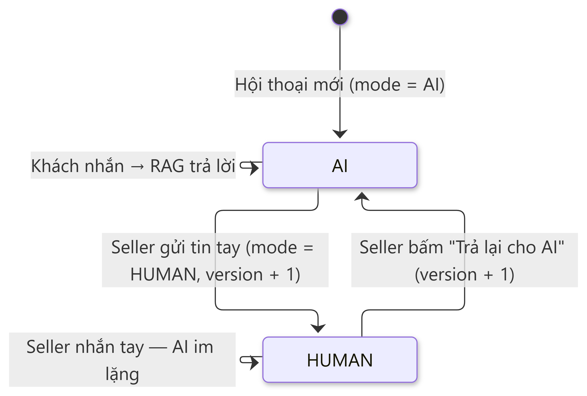

# Sơ đồ RAG — Inbox AI tư vấn 24/7 (LiveOrder)

> Tài liệu mô tả **đúng pipeline đang chạy trong code** (không phải RAG lý thuyết).
> Nguồn: `lib/rag/*`, `lib/chat/ai.ts`, `lib/chat/flow.ts`, `lib/chat/gateway.ts`.
>
> **Ảnh dùng cho báo cáo:** thư mục `docs/diagrams/` có sẵn **PNG (2200px)** và **SVG (vector)**:
> `rag-1a-nap-tri-thuc`, `rag-1b-truy-van`, `rag-2-tuan-tu`, `rag-3-trang-thai`.
> **Nên chèn PNG vào Word/PowerPoint** (nét ở cỡ 18cm, ~310dpi). Hình 1a, 1b và 3 vừa 1 trang A4 dọc;
> sơ đồ tuần tự (2) nhiều bước, chữ sẽ nhỏ khi in 18cm — nên để phụ lục hoặc xem trên máy cho rõ.
> SVG dùng khi cần vector (web, LaTeX, Figma); Word có thể không hiển thị đủ nhãn trong SVG.
>
> Muốn sửa sơ đồ: sửa khối Mermaid dưới đây rồi render lại (VS Code + extension
> "Markdown Preview Mermaid Support", hoặc [mermaid.live](https://mermaid.live)).

---

## 1. Kiến trúc RAG — 2 giai đoạn

### 1.1 Giai đoạn nạp tri thức (offline, lazy — mỗi shop một index)





### 1.2 Giai đoạn truy vấn (mỗi tin nhắn của khách)





> **Nhánh phụ (không đi RAG):** câu hỏi về đơn (`#mã` / "đơn" / "thanh toán") → trả **template đọc thẳng DB** theo `buyerId + shopId`, không gọi LLM. Nếu seller đã tiếp quản (`mode = HUMAN`) → AI im lặng (xem sơ đồ trạng thái ở mục 3).

### Điểm cốt lõi cần nói khi bảo vệ

- **Index tách theo từng shop**: `retrieve` chỉ trả entry của đúng `shopId` → không lẫn tri thức shop khác.
- **Giá/kho KHÔNG nằm trong vector**: chỉ tên/SKU sản phẩm được embed; giá/kho đọc từ DB **ngay lúc dựng prompt** → luôn đúng, đổi giá không cần đánh lại index.
- **SKU nêu rõ được tra chính xác** (`findExactSku`), không thay bằng sản phẩm "gần giống" qua cosine.
- **Câu hỏi về đơn đi đường template, không gọi LLM** → không bao giờ bịa trạng thái đơn; query scope `{buyerId, shopId}` nên không lộ đơn người khác.
- **Fallback**: Groq lỗi/thiếu key → khách vẫn nhận toàn bộ KB shop (không "chết" tính năng tư vấn).
- **Trace minh bạch**: top-5 + điểm, model, token, thời gian được lưu vào `DirectMessage.trace` và hiển thị ở UI ("Vì sao AI trả lời").

---

## 2. Sơ đồ tuần tự — một lượt hỏi đáp RAG





---

## 3. Sơ đồ trạng thái — AI / người thật tiếp quản





---

## 4. Sơ đồ ASCII (dán nhanh vào Word nếu chưa render Mermaid)

```text
GIAI ĐOẠN 1 — NẠP TRI THỨC (lazy, mỗi shop 1 index trong RAM)
  KbEntry(title, answer) ─┐
                          ├─► ghép text ─► e5-small (local, 384d, "passage:")
  Product(name, sku) ─────┘                     │
                                               ▼
                          Vector index RAM: Map<shopId, entries + vectors>
                          (normalize sẵn → cosine = dot product)
  KB/tên/SKU đổi → invalidateShopIndex(shopId) → lần retrieve sau dựng lại

GIAI ĐOẠN 2 — TRUY VẤN
  Khách gửi tin (socket /inbox, JWT)
        │
        ▼
  flow.ts: lưu tin BUYER ──► phát realtime cho 2 cửa sổ
        │
        ├─ mode = HUMAN? ──► dừng (seller đã tiếp quản)
        ▼
  Câu hỏi về đơn? ──có──► Template từ DB (không gọi LLM)
        │ không
        ▼
  RAG: embed "query:" → cosine với index shop → top-5
        │
        ▼
  Ngữ cảnh: KB top-5 + TOÀN BỘ sản phẩm (giá/kho hiện tại)
            + live đang mở + 20 tin gần nhất
        │
        ▼
  buildPrompt → Groq (qwen3.8-27b, timeout 20s)
        │ OK                          │ GroqError
        ▼                             ▼
  Câu trả lời + trace            Fallback FULL_KB
        └──────────────┬──────────────┘
                       ▼
  Lưu DirectMessage(AI) + trace JSON → phát socket
                       ▼
  UI: bubble AI + chip nguồn + "Vì sao AI trả lời"
```

---

## 5. Thành phần ↔ file code

| Thành phần | File | Vai trò |
|---|---|---|
| Điều phối lượt chat | `lib/chat/flow.ts` | Lưu tin, phát realtime, kiểm tra mode, history 20 tin, chống race takeover (version) |
| Runner AI 3 nhánh | `lib/chat/ai.ts` | Template đơn / RAG / fallback FULL_KB; `buildPrompt` |
| Vector index | `lib/rag/index.ts` | Index RAM theo shop, cosine top-5, `findExactSku`, invalidate |
| Embedder | `lib/rag/embedder.ts` | e5-small q8 384d, lazy, singleton `globalThis` |
| Groq client | `lib/rag/groq.ts` | HTTP thuần, timeout 20s, `GroqError` |
| Trace | `lib/chat/trace.ts` | Schema trace an toàn cho client (topK, products, tokens, fallback, error) |
| Gateway socket | `lib/chat/gateway.ts` | JWT handshake, chỉ chủ hội thoại được join/send |
| Invalidate index | `lib/kb/service.ts`, `lib/products/service.ts` | Gọi `invalidateShopIndex` sau mỗi mutation |
| Lưu trữ | `prisma/schema.prisma` | `KbEntry`, `Product`, `Conversation(mode, version)`, `DirectMessage.trace` |

## 6. Tham số đang dùng

| Tham số | Giá trị | Nơi khai báo |
|---|---|---|
| Embedding model | `Xenova/multilingual-e5-small` (q8, 384 chiều) | `lib/rag/embedder.ts` |
| Tiền tố e5 | `query:` / `passage:` | `buildEmbedText` |
| top-K | 5 | `DEFAULT_TOP_K` |
| Độ tương đồng | cosine (dot trên vector đã normalize) | `dot()` |
| Lịch sử hội thoại | 20 tin gần nhất | `HISTORY_TAKE` |
| LLM | `qwen/qwen3.8-27b` (override bằng `GROQ_MODEL`) | `lib/rag/groq.ts` |
| Timeout LLM | 20 giây | `DEFAULT_TIMEOUT_MS` |
| Fallback | Toàn bộ KB của shop (`FULL_KB`) | `buildFallbackContent` |
| Câu hỏi đơn | regex `#số` hoặc từ khoá đơn/thanh toán/chuyển khoản/giao chưa | `isOrderQuestion` |
